# Ticket #27: Read chunks by id. Explained from zero

*Study notes for Aira. Written 2026-11-26. Ticket: https://github.com/christocar/Study-Buddy-RAG_DE25/issues/27*
*Code: `src/study_buddy/storage/postgres.py` -> `read_chunks_by_ids()` · Tests: `tests/test_storage_postgres.py` (T10 to T16)*
*Companion files: `scratch/aira/agents/04_read_chunks_by_id_27.md` (the task tracker) and `pr_26_save_to_postgres.md` (the ticket before this one)*

---

## 0. The whole ticket in 30 seconds

> LanceDB (the vector search) answers a question with **a list of numbers**: "the closest chunks are 44, 41 and 43."
> Numbers are useless to a student. So `read_chunks_by_ids()` goes to **Postgres** and turns those numbers back into **real text + the file name + the place** (page or second), in the **same order**.

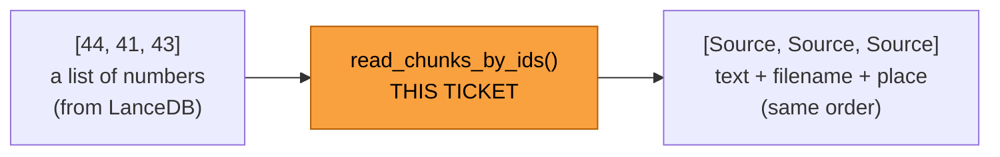

That is all it does. Everything below explains **why** it is needed, **how** the pieces fit and **what each line of code means**.

### Table of contents

1. [Why two databases? (the library story)](#1-why-two-databases-the-library-story)
2. [The big picture: upload path and ask path](#2-the-big-picture-upload-path-and-ask-path)
3. [Where ticket #27 sits](#3-where-ticket-27-sits)
4. [The data: two tables and one model](#4-the-data-two-tables-and-one-model)
5. [A full worked example with real numbers](#5-a-full-worked-example-with-real-numbers)
6. [The SQL, piece by piece](#6-the-sql-piece-by-piece)
7. [The order problem (the tricky part)](#7-the-order-problem-the-tricky-part)
8. [The Python code, line by line](#8-the-python-code-line-by-line)
9. [Edge cases](#9-edge-cases)
10. [The tests](#10-the-tests)
11. [Decisions D1 to D7 and why](#11-decisions-d1-to-d7-and-why)
12. [Try it yourself](#12-try-it-yourself)
13. [Mistakes everyone makes (including me)](#13-mistakes-everyone-makes-including-me)
14. [Self-quiz](#14-self-quiz)
15. [Glossary](#15-glossary)

---

## 1. Why two databases? (the library story)

The app uses **two** databases. This is the part that confuses most people, so start here.

| | **Postgres** | **LanceDB** |
|---|---|---|
| Library comparison | The **shelves with the real books** and the catalogue cards | A **magic index** that knows which books are *about the same thing* |
| What it keeps | The real text, file name, page/second | Only a **number** (`chunk_id`) and a **vector** (1024 numbers describing the meaning) |
| What it is good at | Exact lookup: "give me row 44" | Fuzzy lookup: "which chunks mean something similar to this question?" |
| What it is bad at | Finding things by *meaning* | Storing and returning readable text |
| Question it answers | "What is the text of chunk 44?" | "Which chunk numbers are closest to this question?" |

**Why not keep everything in one place?** A vector search can only say *"these numbers are the closest"*. It does not hand you a neat sentence with a file name. So we need a second step to go from number to text. **That second step is ticket #27.**

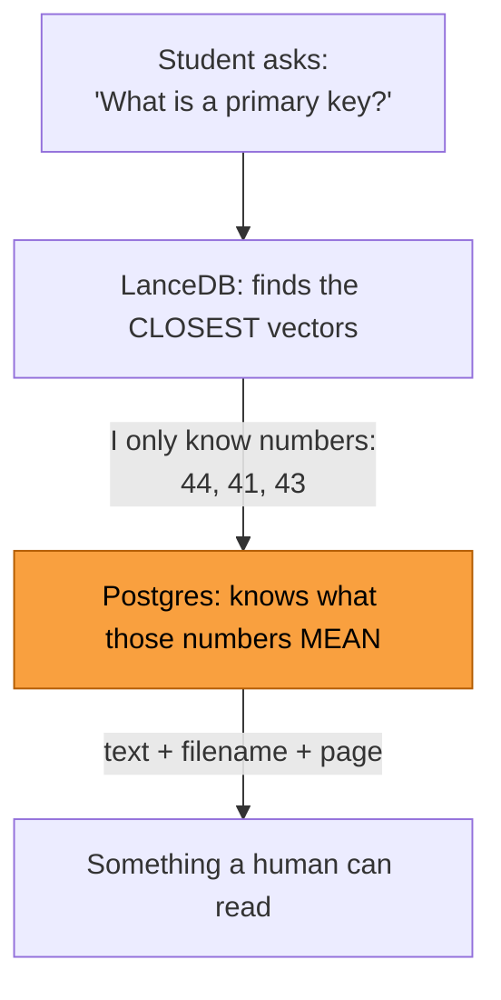

**The glue between the two databases is `chunk_id`.** Postgres makes the number when it saves a chunk (ticket #26). LanceDB stores its vector under the *same* number. Same number = same chunk, in both places.

---

## 2. The big picture: upload path and ask path

The app has **two journeys**. Ticket #26 belongs to the first, ticket #27 to the second.

### Journey 1: UPLOAD (happens once per file)

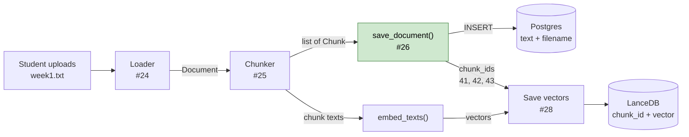

### Journey 2: ASK (happens every time someone asks a question)

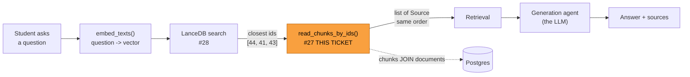

**Key idea:** the upload path is *write*, the ask path is *read*. #26 writes rows. #27 reads the same rows back, later, when someone asks a question.

---

## 3. Where ticket #27 sits

Who calls what, in time order, for one question:

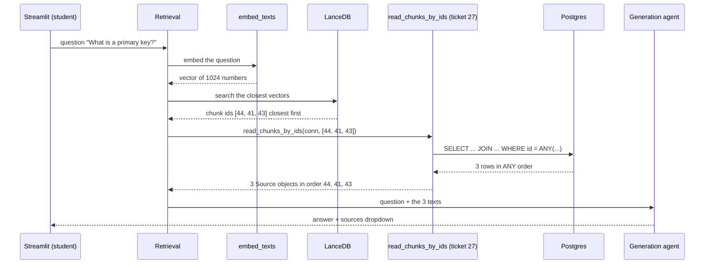

Notice: **#27 is a small, boring bridge.** It does not search, does not call an LLM and does not write anything. It only translates *ids -> readable sources*. Small and boring is good: easy to test.

---

## 4. The data: two tables and one model

### The tables (`sql/schema.sql`)

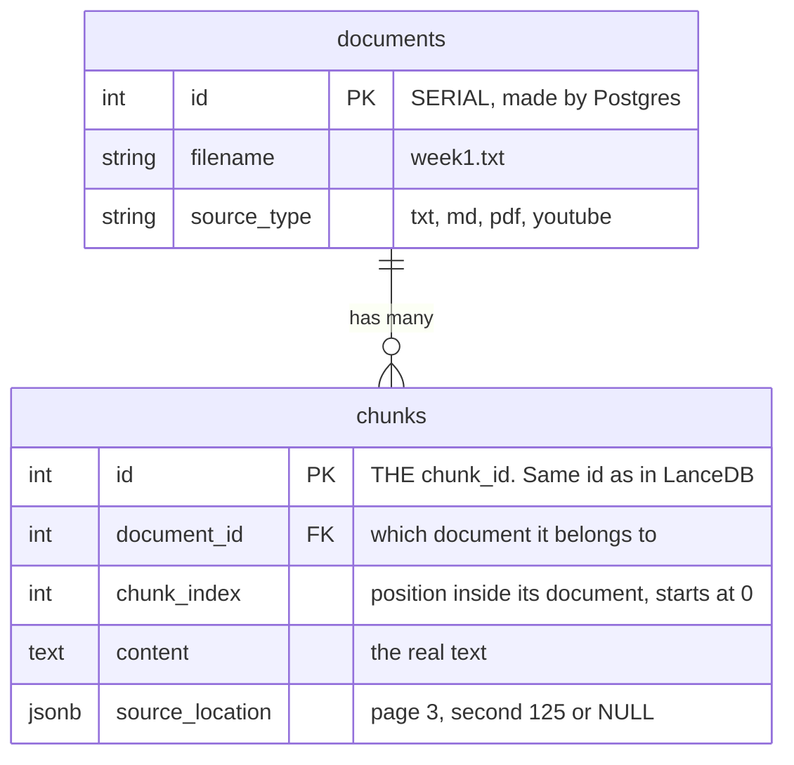

**One document has many chunks.** Each chunk points back to its document with `document_id`. The **file name is stored once, in `documents`**, not repeated on every chunk. That is good database design (no copy-paste of data), but it is exactly **why we need a JOIN**.

### The model (`src/study_buddy/models.py`)

`Source` is **one row in the sources dropdown** in the frontend. This is the shape we must return:

| `Source` field | Type | Comes from | In plain words |
|---|---|---|---|
| `chunk_id` | `int` | `chunks.id` | Which chunk it is |
| `filename` | `str` | `documents.filename` | Which file it came from. **Needs the JOIN** |
| `source_location` | `dict` or `None` | `chunks.source_location` | `{"page": 3}`, `{"second": 125}` or nothing |
| `content` | `str` | `chunks.content` | The actual text |

> `Answer` (what `POST /ask` returns) is simply `answer: str` + `sources: list[Source]`. So our function's output plugs straight into `Answer(sources=...)`. That is what test T16 proves.

### Two numbers that look alike but are NOT the same

| | `chunk_index` | `chunk_id` |
|---|---|---|
| Meaning | Position **inside one document** | Unique number in the **whole database** |
| Starts at | **0 in every document** | Wherever Postgres is (41, 42, 43...) |
| Who makes it | The chunker (#25) | Postgres, when saving (#26) |
| Used in LanceDB? | No | **Yes. This is the link** |
| Used in #27? | No | **Yes. We look chunks up by this** |

Two documents can both have a chunk with `chunk_index = 0`. They can **never** share a `chunk_id`.

---

## 5. A full worked example with real numbers

Pretend the upload path has already run for two files. This is what is in Postgres:

**Table `documents`**

| id | filename | source_type |
|---|---|---|
| 7 | `week1.txt` | txt |
| 8 | `lecture.pdf` | pdf |

**Table `chunks`**

| id (= chunk_id) | document_id | chunk_index | content | source_location |
|---|---|---|---|---|
| 41 | 7 | 0 | "A primary key uniquely identifies a row..." | NULL |
| 42 | 7 | 1 | "A foreign key points to another table..." | NULL |
| 43 | 7 | 2 | "An index makes lookups faster..." | NULL |
| 44 | 8 | 0 | "Every table should have a primary key..." | `{"page": 3}` |
| 45 | 8 | 1 | "Normalization removes duplicated data..." | `{"page": 4}` |

The student asks: **"What is a primary key?"**

### Step by step

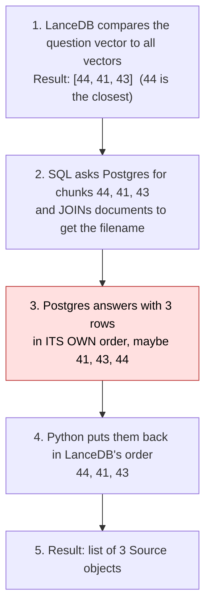

**What step 2 returns (the JOIN result, order NOT guaranteed):**

| chunk_id | filename | source_location | content |
|---|---|---|---|
| 41 | `week1.txt` | NULL | "A primary key uniquely identifies a row..." |
| 43 | `week1.txt` | NULL | "An index makes lookups faster..." |
| 44 | `lecture.pdf` | `{"page": 3}` | "Every table should have a primary key..." |

**What the function finally returns (after fixing the order):**

```python
[
    Source(chunk_id=44, filename="lecture.pdf", source_location={"page": 3}, content="Every table should have a primary key..."),
    Source(chunk_id=41, filename="week1.txt",   source_location=None,        content="A primary key uniquely identifies a row..."),
    Source(chunk_id=43, filename="week1.txt",   source_location=None,        content="An index makes lookups faster..."),
]
```

The student sees in the dropdown: **1. lecture.pdf, page 3 · 2. week1.txt · 3. week1.txt**. The best match is on top.

---

## 6. The SQL, piece by piece

```sql
SELECT c.id AS chunk_id, d.filename, c.source_location, c.content
FROM chunks AS c
JOIN documents AS d ON d.id = c.document_id
WHERE c.id = ANY(%s)
```

| Piece | What it means |
|---|---|
| `FROM chunks AS c` | Start with the `chunks` table. `c` is a short nickname |
| `JOIN documents AS d` | Also bring in the `documents` table, nickname `d` |
| `ON d.id = c.document_id` | **How to match them:** a chunk's `document_id` equals a document's `id` |
| `WHERE c.id = ANY(%s)` | Keep only chunks whose id is **in the list** I give you |
| `SELECT c.id AS chunk_id, ...` | Pick these columns, and **rename** `c.id` to `chunk_id` |

### 6a. What a JOIN does (picture)

Think of every chunk having a **sticker** (`document_id`) that says which document it belongs to. The JOIN follows each sticker to the right catalogue card and copies the file name over.

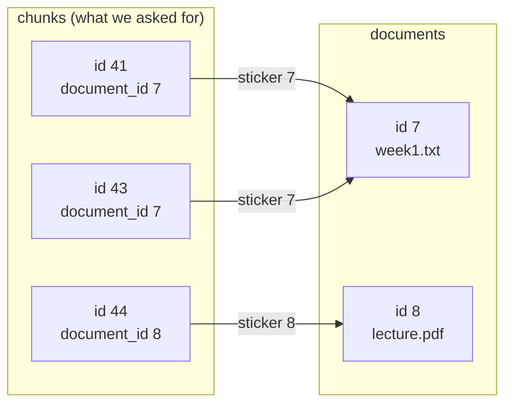

Without the JOIN we would only know `document_id = 8`, which means nothing to a student. They want to read `lecture.pdf`.

### 6b. `ANY(%s)`: send a whole list as ONE value

You want "chunks whose id is 44, 41 **or** 43". There are three ways to write it:

| Way | Verdict |
|---|---|
| Build the string `"... IN (" + ",".join(ids) + ")"` | **NEVER.** SQL injection risk. This is why we use `%s` |
| One query per id in a loop | Works, but 3 trips to the database instead of 1 |
| `WHERE c.id = ANY(%s)` with the Python list as the parameter | **This one.** One query, safe. psycopg turns the Python list into a Postgres array |

The code passes `(chunk_ids,)`: a tuple with **one** thing in it, the list. The trailing comma matters: `(chunk_ids,)` is a tuple, `(chunk_ids)` is just the list in parentheses.

> **Rule in this project:** values always go in as `%s` parameters, **never** inside the SQL string with an f-string. Postgres then treats them as data, never as code. (Ticket #26 has a test for this with the text `O'Brien; DROP TABLE chunks;--`.)

### 6c. `AS chunk_id`: why the renaming?

`class_row(Source)` (explained in the next sections) builds a `Source` using the **column names** as field names. So the column names that come out of SQL must match `Source` exactly:

| SQL gives | `Source` expects | OK? |
|---|---|---|
| `chunk_id` (renamed from `c.id`) | `chunk_id` | yes |
| `filename` | `filename` | yes |
| `source_location` | `source_location` | yes |
| `content` | `content` | yes |

Without `AS chunk_id` the column would be called `id`, and `Source` would fail because it has no field `id`.

---

## 7. The order problem (the tricky part)

This is the **most important idea** of the ticket.

**Fact 1:** LanceDB returns ids **closest first**: `[44, 41, 43]`.
**Fact 2:** The sources dropdown and the LLM prompt expect the **best match first**.
**Fact 3:** SQL **does not promise any order** when you use `WHERE ... ANY(...)` without an `ORDER BY`. Postgres may return `41, 43, 44` (often just the order it finds them on disk). It will not follow the order of your list.

So if we returned the rows exactly as Postgres gives them, the **order would be wrong** and the best match could end up at the bottom. Nothing would crash. It would just be quietly wrong. That is the worst kind of bug.

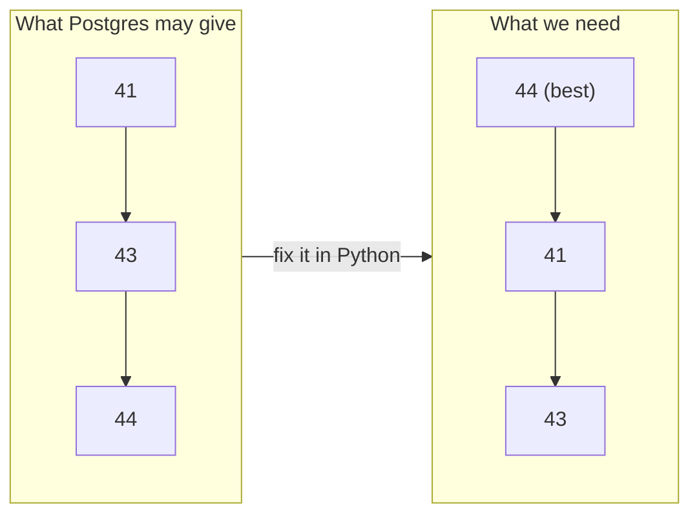

### The fix: a dictionary lookup (D3)

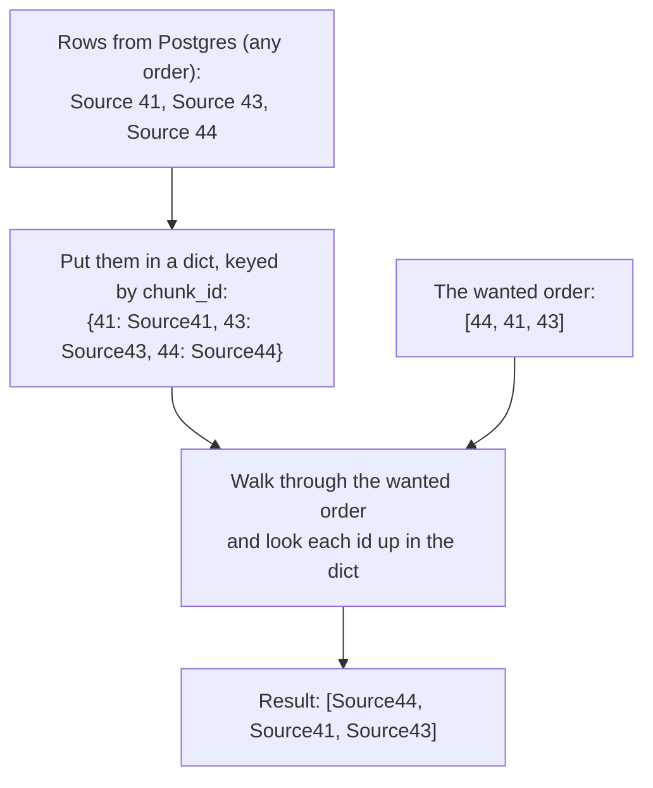

A dict is like a **coat check**: give the ticket number (the id), get the coat (the `Source`) instantly. We hand in tickets in the order we want, so the coats come out in that order.

> **Alternative** I did not use: do the ordering inside SQL with `unnest(%s) WITH ORDINALITY`. It works, but it is harder to read. The lists are tiny (top 5 or so), so a Python dict is simpler and fast enough. See D3.

---

## 8. The Python code, line by line

```python
def read_chunks_by_ids(conn: psycopg.Connection, chunk_ids: list[int]) -> list[Source]:
```

| Part | Meaning |
|---|---|
| `conn` | The connection is **passed in** (same style as `save_document`). The caller owns it, so tests can roll back |
| `chunk_ids: list[int]` | The numbers from LanceDB, closest first |
| `-> list[Source]` | We give back ready-to-use `Source` objects, not raw database rows |

### Part 1: the early exit

```python
    if not chunk_ids:
        return []
```

An empty list means "nothing was found, nothing to look up". We answer straight away and **do not bother the database**. `not chunk_ids` is `True` for `[]`.

### Part 2: the query and the row factory

```python
    with conn.cursor(row_factory=class_row(Source)) as cur:
        sources = cur.execute(
            "SELECT c.id AS chunk_id, d.filename, c.source_location, c.content "
            "FROM chunks AS c JOIN documents AS d ON d.id = c.document_id "
            "WHERE c.id = ANY(%s)",
            (chunk_ids,),
        ).fetchall()
```

| Piece | Meaning |
|---|---|
| `conn.cursor(...)` | A **cursor** is the "pen" you use to send SQL and read answers on a connection |
| `with ... as cur` | The cursor is closed automatically when the block ends |
| `row_factory=class_row(Source)` | **The clever bit.** Normally a row is a plain tuple `(44, "lecture.pdf", {...}, "text")`. A *row factory* changes what each row becomes. `class_row(Source)` means: **make a `Source` from each row**, using the column names as the field names |
| `.fetchall()` | Get **all** the rows as a list. Because of the row factory it is already a `list[Source]` |

What `class_row` does for one row, written by hand:

```python
# you write this by hand without class_row:
Source(chunk_id=row[0], filename=row[1], source_location=row[2], content=row[3])

# class_row(Source) does it for you, matching by COLUMN NAME
```

Two things psycopg does for free that match what `Source` wants:

| In Postgres | In Python | Matches `Source`? |
|---|---|---|
| `JSONB` column with `{"page": 3}` | a `dict` | yes: `source_location: dict | None` |
| `NULL` | `None` | yes |

> `Source` uses `extra="forbid"`. That means if the SQL returned **an extra column** (say `d.id`), building the `Source` would fail loudly. Good: mismatches show up immediately, not silently.

### Part 3: put them back in order

```python
    by_id = {source.chunk_id: source for source in sources}
    return [
        by_id[chunk_id] for chunk_id in dict.fromkeys(chunk_ids) if chunk_id in by_id
    ]
```

Read it as three small ideas:

**(a) The dict.** `{source.chunk_id: source for source in sources}` builds the coat check: id -> `Source`.

```python
by_id = {41: Source(41...), 43: Source(43...), 44: Source(44...)}
```

**(b) `dict.fromkeys(chunk_ids)`.** A dict cannot have the same key twice, and it **remembers the order the keys were added**. So `dict.fromkeys([44, 41, 44, 43])` gives keys `44, 41, 43`: **duplicates gone, first place kept.** It is a neat trick to remove duplicates without losing order. (A `set` would lose the order.)

**(c) `if chunk_id in by_id`.** If an id is not in the dict, Postgres did not find it, so we **skip** it instead of crashing with a `KeyError`.

Putting (a), (b), (c) together as a table. Wanted `[44, 41, 99, 44, 43]`:

| Loop step | `chunk_id` | Already seen? | In `by_id`? | Result |
|---|---|---|---|---|
| 1 | 44 | no | yes | **added** `Source44` |
| 2 | 41 | no | yes | **added** `Source41` |
| 3 | 99 | no | **no** | skipped (not in Postgres) |
| 4 | 44 | **yes** (removed by `fromkeys`) | | gone |
| 5 | 43 | no | yes | **added** `Source43` |

Final: `[Source44, Source41, Source43]`.

### The whole function as one picture

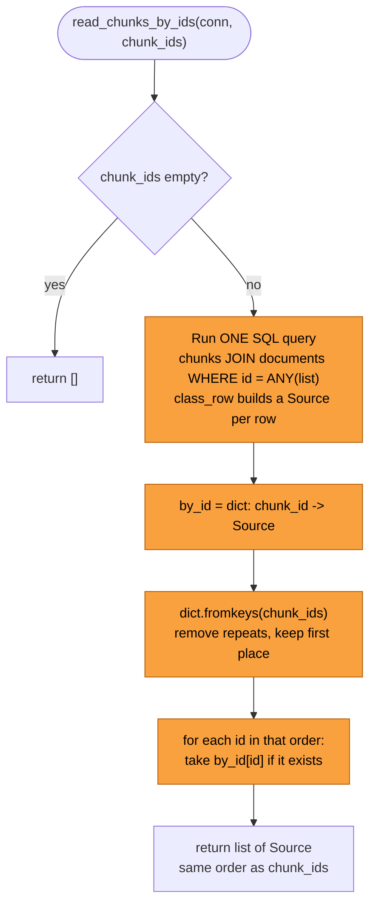

---

## 9. Edge cases

What happens when the input is "weird"? A good function has a clear answer for each.

| Situation | Example input | Result | Why (decision) |
|---|---|---|---|
| Normal | `[44, 41, 43]` | 3 `Source`, in that order | The happy path |
| Empty list | `[]` | `[]`, no DB call | D5 |
| Id not in Postgres | `[41, 9999, 42]` | `[Source41, Source42]` (shorter) | D4: skip it |
| Same id twice | `[42, 41, 42]` | `[Source42, Source41]` | D6: once, at first place |
| `source_location` is NULL | a `.txt` chunk | `source_location=None` | psycopg: NULL -> `None` |
| Chunks from 2 documents | `[44, 41]` | each has its **own** filename | The JOIN, T12 |

**Why skip an unknown id instead of raising an error?** This can really happen: LanceDB has a vector, but the matching chunk is missing in Postgres (e.g. a document was deleted, or the upload crashed halfway). If we crashed, **one broken id would kill the whole question**. Skipping lets the student still get an answer from the other chunks. In phase 3 the *reconciliation* task will find these orphan vectors and clean up.

---

## 10. The tests

All 7 new tests are in `tests/test_storage_postgres.py`. They run against the **real Postgres in Docker**, and they use `save_document()` from #26 to create the rows first (arrange), then call `read_chunks_by_ids()` (act), then check (assert).

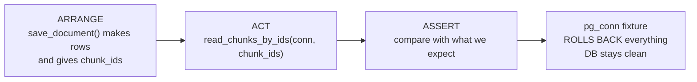

| # | Test name | What it proves | Edge case |
|---|---|---|---|
| T10 | `test_read_returns_sources_with_filename` | Each `Source` has the right content, location **and filename** | NULL vs `{"page": 3}` |
| T11 | `test_read_keeps_the_order_of_the_ids` | Asking `[id2, id0, id1]` gives back that exact order | **The order problem** |
| T12 | `test_read_across_two_documents` | Two documents -> each chunk gets its **own** filename | **The JOIN** |
| T13 | `test_read_empty_list` | `[]` in, `[]` out | D5 |
| T14 | `test_read_skips_unknown_id` | An id that does not exist is skipped, the rest still come back | D4 |
| T15 | `test_read_returns_a_repeated_id_once` | `[b, a, b]` gives `[b, a]` | D6 |
| T16 | `test_read_result_fits_answer` | Result is `Source` objects and `Answer(answer=..., sources=result)` is valid | The model contract |

**Where do the "unknown" ids come from in T14?** `max(chunk_ids) + 1000`: a number that is certainly bigger than every saved id, so it cannot exist. Better than a hardcoded `999999`, which could (in theory) exist someday.

**Remember:** in CI these tests are **skipped** (GitHub has no Postgres, `POSTGRES_HOST` is not set). They run on your computer.

---

## 11. Decisions D1 to D7 and why

Every function has choices. These are the ones made for #27, and the reason in one line.

| ID | Question | What we chose | Why | Alternative not chosen |
|---|---|---|---|---|
| D1 | Name and signature | `read_chunks_by_ids(conn, chunk_ids) -> list[Source]` | Same style as `save_document(conn, ...)`. Retrieval gets ready `Source` objects | `get_sources(...)` |
| D2 | Which file | `storage/postgres.py`, next to #26 | "Everything that talks to Postgres lives in this file" | A separate file |
| D3 | Keep the order | Python dict | Easy to read. Lists are tiny | `unnest(...) WITH ORDINALITY` in SQL |
| D4 | Unknown id | Skip it | One bad id must not break a whole question | Raise an error |
| D5 | Empty list | Return `[]` without asking the DB | Nothing to look up | Run the query anyway |
| D6 | Repeated id | Return it once, at first place | A dropdown with the same source twice is noise | Return it twice |
| D7 | Row -> `Source` | `class_row(Source)` | psycopg builds the model itself, less code | `dict_row` + `Source(**row)` |

---

## 12. Try it yourself

### 12a. Run the tests

You need Docker Desktop running and `POSTGRES_*` in your own `.env`.

```powershell
docker compose up -d postgres
```

```powershell
uv run --env-file .env pytest tests/test_storage_postgres.py -v
```

Expect **16 passed** (9 from #26 + 7 new). Then once **without** `--env-file` to see them skip, like in CI:

```powershell
uv run pytest -v
```

### 12b. Play with the SQL in pgAdmin

Open the Query Tool (see the steps in `pr_26_save_to_postgres.md`). Run these **one at a time** (select it, press F5). Use ids that really exist in your table (`SELECT id FROM chunks;` first).

**1. See the JOIN working:**

```sql
SELECT c.id AS chunk_id, d.filename, c.source_location, c.content
FROM chunks AS c
JOIN documents AS d ON d.id = c.document_id
WHERE c.id = ANY('{3,1,2}');
```

**2. See that the order is NOT yours.** You asked for `{3,1,2}`. Look at the order of the rows you get back. That is the whole reason for the dict in Python.

**3. See what the JOIN adds.** Same query but without the JOIN, then compare:

```sql
SELECT id, document_id, content FROM chunks WHERE id = ANY('{3,1,2}');
```

You get `document_id` (a number) instead of `filename`. That is the gap the JOIN fills.

**4. Ask for an id that does not exist:**

```sql
SELECT id FROM chunks WHERE id = ANY('{1, 999999}');
```

Postgres does not complain. It just returns fewer rows. Same behaviour the function relies on (D4).

> In pgAdmin you write `'{3,1,2}'` (a Postgres array literal). In Python you pass a real list and psycopg does this conversion for you.

### 12c. Call it from Python

```python
from study_buddy.storage.postgres import get_connection, read_chunks_by_ids

with get_connection() as conn:
    sources = read_chunks_by_ids(conn, [3, 1, 2])

for s in sources:
    print(s.chunk_id, s.filename, s.source_location, s.content[:40])
```

---

## 13. Mistakes everyone makes (including me)

| Mistake | Why it hurts | What to remember |
|---|---|---|
| Mixing up `chunk_index` and `chunk_id` | You look up the wrong chunk, or in the wrong DB | `chunk_index` = position in a file. `chunk_id` = the global id and the LanceDB link |
| Assuming SQL returns rows in the order of the list | Best match ends up last. No error, just wrong | **No `ORDER BY` = no promise.** Fix the order yourself |
| Building the SQL with an f-string | SQL injection | Always `%s` |
| Forgetting the trailing comma in `(chunk_ids,)` | psycopg gets the wrong thing | A one-item tuple needs the comma |
| Forgetting `AS chunk_id` | `class_row` cannot build `Source` (`id` is not a field) | Column names must equal field names |
| Using `set(chunk_ids)` to remove duplicates | Loses the order | `dict.fromkeys()` keeps the order |
| Crashing on a missing id | One orphan vector kills the whole question | Skip it, log it later (phase 3) |
| Calling `commit` here | Not needed. This function only reads | Reading changes nothing, so there is nothing to save |

---

## 14. Self-quiz

Cover the right column and answer out loud. If you can answer all of these, you understand the ticket.

| Question | Answer |
|---|---|
| Why do we have two databases? | Postgres keeps the real text and metadata. LanceDB finds the closest meaning by vector. Neither does the other's job well |
| What links a row in Postgres to a vector in LanceDB? | The same `chunk_id` (`chunks.id`) |
| What does `read_chunks_by_ids` take and return? | A list of chunk ids (closest first) -> a list of `Source` in the same order |
| Why do we need a JOIN? | `filename` lives in `documents`, not in `chunks`. The JOIN follows `document_id` to get it |
| Why `ANY(%s)` and not a loop or an f-string? | One query for the whole list, and safe because it is a parameter |
| Why must the order be fixed in Python? | SQL gives no order promise, and the dropdown and the LLM want the best match first |
| What does `class_row(Source)` do? | Builds a `Source` from each row by matching column names to field names |
| Why `AS chunk_id`? | So the column name matches the `Source` field name |
| What does `dict.fromkeys(ids)` do here? | Removes repeated ids but keeps the first place and the order |
| What happens with an id that is not in Postgres? | It is skipped. The result is shorter than the input |
| Who calls this function, and when? | Retrieval, right after the LanceDB search |
| Why are these tests skipped in CI? | GitHub has no Postgres and `POSTGRES_HOST` is not set |

---

## 15. Glossary

| Word | Simple meaning |
|---|---|
| **RAG** | Retrieval-Augmented Generation. Find relevant text first (retrieval), then let an LLM answer using only that text (generation) |
| **Chunk** | A small piece of a document (a few sentences or a paragraph) |
| **Embedding / vector** | A list of numbers (1024 for us) that captures the *meaning* of a text. Similar meaning = similar numbers |
| **Vector search** | Finding the vectors closest to the question's vector |
| **LanceDB** | The vector database. Stores `chunk_id` + vector |
| **Postgres** | The normal (relational) database. Stores documents and chunks as rows |
| **JOIN** | Combine rows from two tables where a column matches |
| **Foreign key** | A column that points to another table's id (`chunks.document_id` -> `documents.id`) |
| **Alias (`AS`)** | A temporary new name for a column or table inside one query |
| **Parameter (`%s`)** | A placeholder. The value is sent separately, so it can never be run as SQL |
| **psycopg** | The Python library that talks to Postgres |
| **Cursor** | The object you use to run SQL and fetch results on a connection |
| **Row factory** | A setting that decides what Python object each result row becomes (tuple, dict, model...) |
| **`class_row`** | A row factory that builds a class (here `Source`) from each row |
| **JSONB** | A Postgres column type for JSON. psycopg returns it as a Python `dict` |
| **Transaction** | A group of DB steps that succeed or fail together |
| **Rollback** | Undo everything in the current transaction. Our tests do this so the DB stays clean |
| **Fixture (`pg_conn`)** | A pytest helper that prepares something a test needs (here a connection) and cleans up after |
| **Pydantic model** | A class that checks the shape and types of data (`Source`, `Answer`...) |
| **Orphan vector** | A vector in LanceDB with no chunk in Postgres. Phase 3 reconciliation finds them |

---

*Changelog: 2026-11-26. Created from the code in the working tree of `feat/read-chunks-by-id` (not committed yet) and the tracker `04_read_chunks_by_id_27.md`.*
