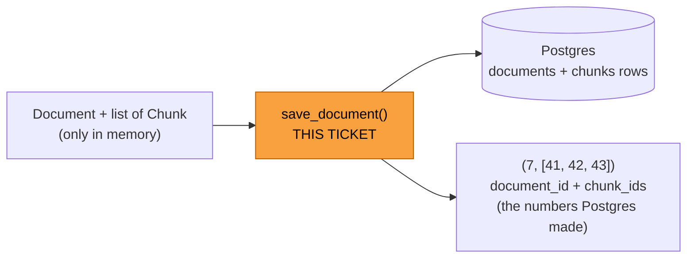
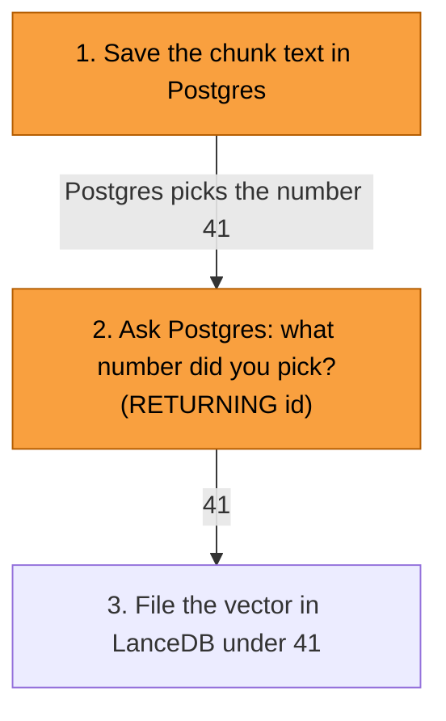
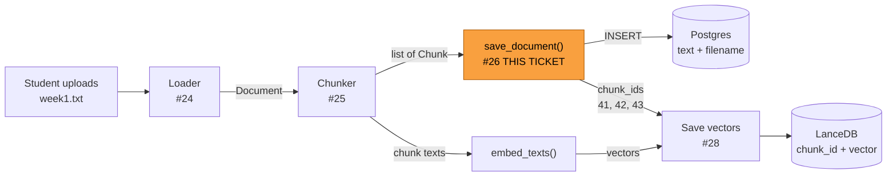
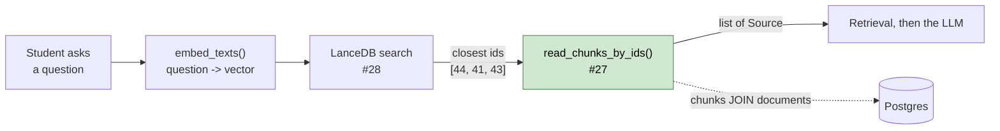
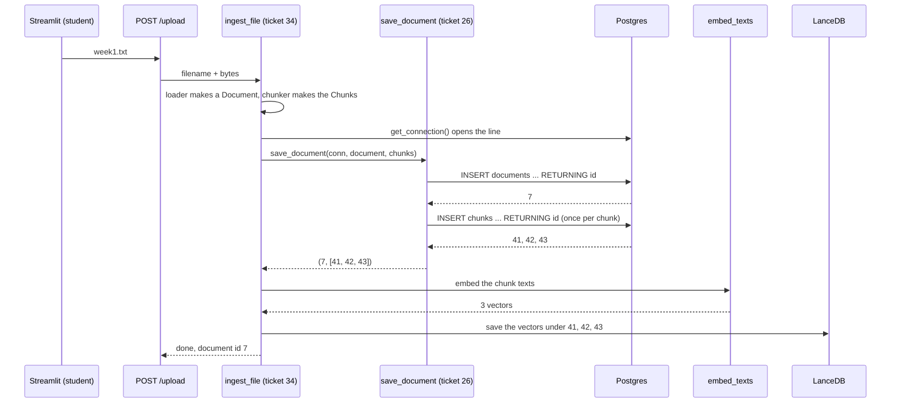
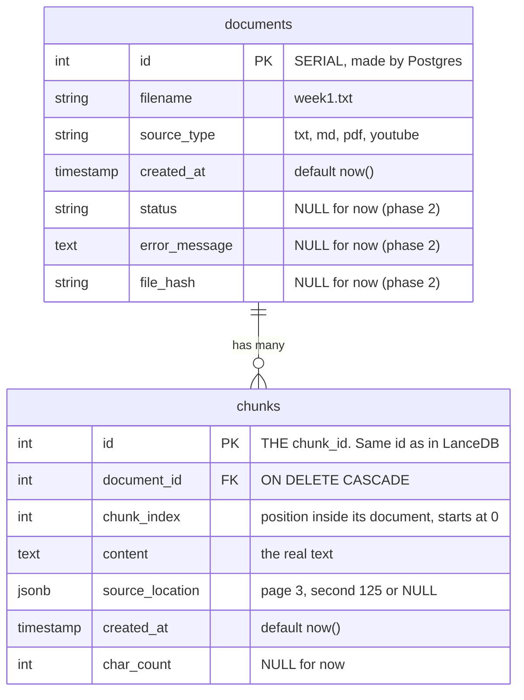
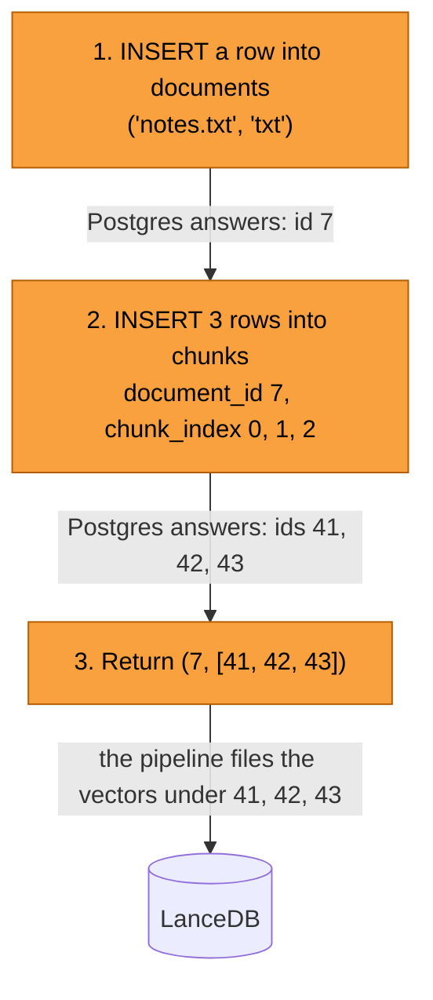
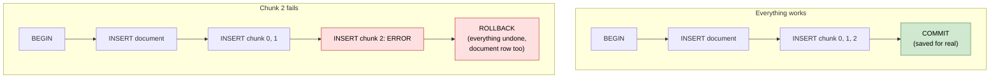
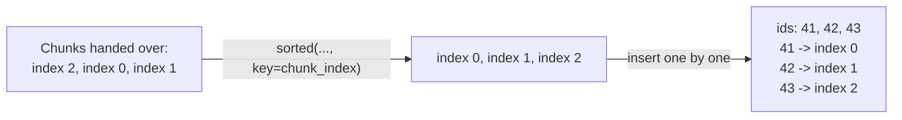
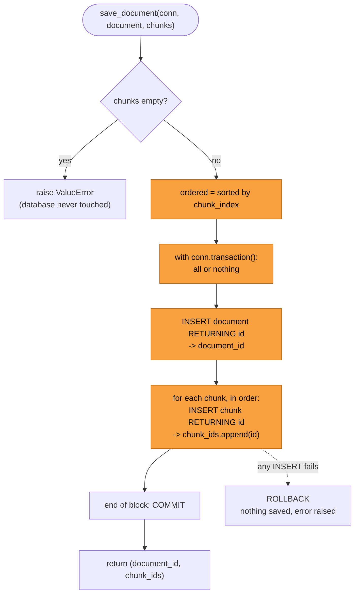

# Ticket #26: Save to Postgres. Explained from zero

---

## 0. The whole ticket overview

> The app turns an uploaded file into a `Document` and a list of `Chunk`s. They are only Python objects in memory, so they vanish when the program ends.
> `save_document()` **writes them into Postgres** and hands back the **numbers Postgres made for them** (`document_id` and one `chunk_id` per chunk).
> Those chunk numbers matter a lot: the vectors in LanceDB are filed under them.



That is all it does. Everything below explains **why** it is needed, **how** the pieces fit and **what each line of code means**.

### Table of contents

1. [Why two databases, and why Postgres goes first](#1-why-two-databases-and-why-postgres-goes-first)
2. [The big picture: upload path and ask path](#2-the-big-picture-upload-path-and-ask-path)
3. [Where ticket #26 sits](#3-where-ticket-26-sits)
4. [The data: two tables and two models](#4-the-data-two-tables-and-two-models)
5. [A full worked example with real numbers](#5-a-full-worked-example-with-real-numbers)
6. [The SQL, piece by piece](#6-the-sql-piece-by-piece)
7. [The tricky parts: all or nothing, and the order of the ids](#7-the-tricky-parts-all-or-nothing-and-the-order-of-the-ids)
8. [The Python code, line by line](#8-the-python-code-line-by-line)
9. [Edge cases](#9-edge-cases)
10. [The tests (and the `pg_conn` fixture)](#10-the-tests-and-the-pg_conn-fixture)
11. [Decisions and why](#11-decisions-and-why)
12. [Try it yourself](#12-try-it-yourself)

---

## 1. Why two databases, and why Postgres goes first

The app uses **two** databases. Start here, because the whole ticket depends on it.

| | **Postgres** | **LanceDB** |
|---|---|---|
| Library comparison | The **shelves with the real books** and the catalogue cards | A **magic index** that knows which books are *about the same thing* |
| What it keeps | The real text, file name, page/second | Only a **number** (`chunk_id`) and a **vector** (1024 numbers describing the meaning) |
| Good at | Exact lookup: "give me row 44" | Fuzzy lookup: "which chunks mean something similar to this question?" |
| Bad at | Finding things by *meaning* | Storing and returning readable text |

**The number is the glue between them.** At question time LanceDB says "the closest chunks are 44, 41 and 43", and Postgres turns those numbers back into text (that is ticket #27).

### So why does Postgres save first?

Because **Postgres is the one that makes the number.** The `id` column is a `SERIAL`: Postgres counts up by itself each time a row is inserted. We cannot invent the number ourselves. We have to *ask* Postgres what it picked, and only then can LanceDB file the vector under the same number.



If we did it the other way around (vector first), we would have no number to file it under. **That is why this ticket returns the ids.**

---

## 2. The big picture: upload path and ask path

The app has **two journeys**. Ticket #26 belongs to the first, ticket #27 to the second.

### Journey 1: UPLOAD (happens once per file). #26 is here



### Journey 2: ASK (every time someone asks a question). #27 is here



**Key idea:** #26 *writes* the rows that #27 *reads back* later. They are two halves of the same bridge.

---

## 3. Where ticket #26 sits

Who calls what, in time order, for one uploaded file:



Notice: **#26 is a small, careful bridge.** It does no embedding, no vector work and no reading. It only writes rows and reports the ids back. The pipeline (`ingest_file`, ticket #34, Johnny) calls it.

---

## 4. The data: two tables and two models

### The tables (`sql/schema.sql`)



Two rules in the schema that the code depends on:

| Rule in `schema.sql` | What it means | Where it matters |
|---|---|---|
| `UNIQUE (document_id, chunk_index)` | One document cannot have two chunks in the same place | Test T9 breaks it on purpose |
| `ON DELETE CASCADE` | If a document is deleted, its chunks go too | Cleanup in pgAdmin, and no orphan chunks |

### The models we save from (`src/study_buddy/models.py`)

| Model | Fields | Saved? |
|---|---|---|
| `Document` | `filename`, `source_type`, `sections` | `filename` and `source_type` -> `documents`. **`sections` is NOT saved** (the text is already inside the chunks) |
| `Chunk` | `chunk_index`, `content`, `source_location` | All three -> `chunks`, plus `document_id` from the row we just made |

### From model to table, column by column

| Table.column | Comes from | Note |
|---|---|---|
| `documents.id` | Postgres (`SERIAL`) | Returned with `RETURNING id` |
| `documents.filename` | `Document.filename` | |
| `documents.source_type` | `Document.source_type` | |
| `documents.created_at` | Postgres default `now()` | We don't send it |
| `documents.status`, `error_message`, `file_hash` | nothing, **NULL** | Phase 2 |
| `chunks.id` | Postgres (`SERIAL`) | **This is the `chunk_id`**. Returned with `RETURNING id` |
| `chunks.document_id` | the `documents.id` we just got | Foreign key |
| `chunks.chunk_index` | `Chunk.chunk_index` | |
| `chunks.content` | `Chunk.content` | |
| `chunks.source_location` | `Chunk.source_location` | JSONB. A dict must be wrapped in `Jsonb(...)`. `None` becomes NULL |
| `chunks.char_count` | nothing, **NULL** | Phase 2 |

### Two numbers that look alike but are NOT the same

| | `chunk_index` | `chunk_id` |
|---|---|---|
| Meaning | Position **inside one document** | Unique number in the **whole database** |
| Starts at | **0 in every document** | Wherever Postgres is (41, 42, 43...) |
| Who makes it | The chunker (#25) | **Postgres, when saving (this ticket)** |
| Used in LanceDB? | No | **Yes. This is the link** |

Two documents can both have a chunk with `chunk_index = 0`. They can **never** share a `chunk_id`.

---

## 5. A full worked example with real numbers

Two files get uploaded, one after the other.

### Upload 1: `notes.txt` with 3 chunks

The pipeline hands over:

```python
document = Document(filename="notes.txt", source_type="txt", sections=[...])
chunks = [
    Chunk(
        chunk_index=0,
        content="A primary key uniquely identifies a row...",
        source_location=None,
    ),
    Chunk(
        chunk_index=1,
        content="A foreign key points to another table...",
        source_location=None,
    ),
    Chunk(
        chunk_index=2, content="An index makes lookups faster...", source_location=None
    ),
]
```



Postgres now holds:

**Table `documents`**

| id | filename | source_type | status | file_hash |
|---|---|---|---|---|
| 7 | `notes.txt` | txt | NULL | NULL |

**Table `chunks`**

| id (= chunk_id) | document_id | chunk_index | content | source_location |
|---|---|---|---|---|
| 41 | 7 | 0 | "A primary key uniquely identifies a row..." | NULL |
| 42 | 7 | 1 | "A foreign key points to another table..." | NULL |
| 43 | 7 | 2 | "An index makes lookups faster..." | NULL |

The function returns `(7, [41, 42, 43])`.

### Upload 2: `lecture.pdf` with 2 chunks

| What | Value | Note |
|---|---|---|
| `document_id` | **8** | Postgres keeps counting |
| chunk ids | **44, 45** | Keeps counting too, does **not** restart at 1 |
| `chunk_index` | **0, 1** | **Restarts at 0**: it is the position inside *this* document |
| `source_location` | `{"page": 3}`, `{"page": 4}` | A PDF knows its page |

Returns `(8, [44, 45])`. That is exactly what test T7 proves.

> **Remember the two numbers:** `chunk_id` goes up forever across all documents (41, 42, 43, 44, 45...). `chunk_index` starts again at 0 for each document (0, 1, 2 | 0, 1).

---

## 6. The SQL, piece by piece

The function runs two kinds of statement. First the document:

```sql
INSERT INTO documents (filename, source_type) VALUES (%s, %s) RETURNING id
```

Then, once per chunk:

```sql
INSERT INTO chunks (document_id, chunk_index, content, source_location)
VALUES (%s, %s, %s, %s) RETURNING id
```

| Piece | What it means |
|---|---|
| `INSERT INTO documents (filename, source_type)` | Add a new row. Fill only these two columns |
| `VALUES (%s, %s)` | The values, as **placeholders**. They are sent separately (see 6a) |
| `RETURNING id` | **After inserting, hand me back the `id` Postgres just made.** The key trick of this ticket (see 6b) |
| `document_id` in the chunk INSERT | Links the chunk to its document. It is the `id` that the first INSERT returned |

We do **not** send `id` or `created_at`. Postgres fills them: `id` from the `SERIAL` counter and `created_at` from `now()`. Columns we skip (`status`, `error_message`, `file_hash`, `char_count`) become NULL.

### 6a. `%s`: send values separately from the SQL

| Way | Verdict |
|---|---|
| `f"INSERT ... VALUES ('{filename}')"` | **NEVER.** A filename with a quote breaks it, and a clever one can run its own SQL: **SQL injection** |
| `VALUES (%s)` with the value passed separately | **This one.** The value is always treated as plain data, never as code |

Test T6 proves it with the text `O'Brien; DROP TABLE chunks;--`. If that had been run as SQL, the table would be gone. Instead it is saved as plain text.

> **Rule in this project:** values always go in as `%s`, **never** in the SQL string with an f-string.

### 6b. `RETURNING id`: how we learn the numbers

You insert a row and need to know the id Postgres gave it. There are three options:

| Way | Verdict |
|---|---|
| Guess: "the last id plus one" (`SELECT max(id) + 1`) | **Wrong.** Ids can skip, and two uploads at once would collide |
| Insert, then `SELECT` the row back to find its id | Two trips, and how do you find *that* row? |
| `INSERT ... RETURNING id` | **This one.** One trip, and Postgres tells you the exact id of the row it just made |

`RETURNING id` makes the INSERT behave like a SELECT too: it gives back a result row `(7,)`. That is why the code ends with `.fetchone()[0]`: `fetchone()` gives the tuple `(7,)` and `[0]` takes the `7` out.

### 6c. `Jsonb` and NULL: the `source_location` column

`source_location` is a `JSONB` column (JSON stored in Postgres' fast binary form).

| Python value | What we send | Result in Postgres |
|---|---|---|
| `{"page": 3}` (a dict) | `Jsonb({"page": 3})` | The JSON `{"page": 3}` |
| `None` | `None` | A real **NULL** (nothing) |

Why the wrapper? psycopg does not know if a Python dict should become JSON, JSONB or something else, so `Jsonb(...)` says: "send this as JSON". And why must `None` stay `None`? Because if we wrapped it, Postgres would store the JSON value `null`, which is **not** the same as a database NULL. `WHERE source_location IS NULL` would then miss it. Test T5 checks both directions.

---

## 7. The tricky parts: all or nothing, and the order of the ids

There are two ideas here. Together they are the heart of the ticket.

### 7a. All or nothing (the transaction)

A document is **several** INSERTs: one for the document and one per chunk. What if INSERT number 3 fails halfway?

| Without a transaction | With a transaction |
|---|---|
| Document row saved, chunk 0 saved, chunk 1 saved, chunk 2 **failed** | Chunk 2 fails, so **everything** is undone, including the document row |
| A half-saved file sits in the database. A search finds half a document | The database looks as if nothing ever happened. Safe to try again |



In the code that is one line: `with conn.transaction():`. When the block ends well it commits. If an error escapes the block, it rolls back. Test T9 checks exactly this.

Three words you will meet:

| Word | Simple meaning |
|---|---|
| **Transaction** | A group of SQL statements that count as one. All saved, or none |
| **Commit** | Make the group permanent |
| **Rollback** | Throw the group away |

### 7b. The order of the ids

The pipeline will do this next:

```python
document_id, chunk_ids = save_document(conn, document, chunks)
# the vector of chunk 0 goes under chunk_ids[0], chunk 1 under chunk_ids[1], ...
```

That only works if **`chunk_ids[i]` belongs to the chunk with `chunk_index == i`**. If the ids came back in a different order, vector 0 would be filed under the id of chunk 2, and every answer would show the wrong source. No crash. Just quietly wrong.

What if the chunker hands over the chunks in a different order, say `2, 0, 1`? The ids are made in the order we insert, so we would get them in the wrong order. The fix is simple: **sort first, then insert**.



Tests T3 and T4 prove this.

> Ticket #27 had the *same kind* of order problem in the opposite direction (SQL returning rows in the wrong order). In both tickets the rule is the same: **never trust the order, make it explicit.**

---

## 8. The Python code, line by line

### Part 1: `get_connection()`

```python
def get_connection() -> psycopg.Connection:
    return psycopg.connect(
        host=os.environ["POSTGRES_HOST"],
        port=os.environ["POSTGRES_PORT"],
        dbname=os.environ["POSTGRES_DB"],
        user=os.environ["POSTGRES_USER"],
        password=os.environ["POSTGRES_PASSWORD"],
    )
```

| Piece | Meaning |
|---|---|
| `psycopg.connect(...)` | Opens the line to Postgres. psycopg is the Python library that talks to it |
| `os.environ["POSTGRES_HOST"]` | Read the value from the **environment** (filled from `.env` by `--env-file`). **No password in the code** |
| `["..."]` with square brackets | If the variable is missing, it fails loudly with a `KeyError`, instead of connecting to the wrong place |

How it is used:

```python
with get_connection() as conn:
    document_id, chunk_ids = save_document(conn, document, chunks)
```

The `with` block does three things for you: **commit** if the block ends well, **rollback** if there is an error, and **close** the line either way.

The five lines used to be copied inside `check_connection.py`. Now both use `get_connection()`: one place to change, not two.

### Part 2: the signature and the early exit

```python
def save_document(
    conn: psycopg.Connection, document: Document, chunks: list[Chunk]
) -> tuple[int, list[int]]:
    if not chunks:
        raise ValueError(f"Cannot save '{document.filename}': no chunks.")
```

| Piece | Meaning |
|---|---|
| `conn` | The connection is **passed in**. The caller owns it, so tests can roll back and the pipeline controls it |
| `-> tuple[int, list[int]]` | Returns `(document_id, chunk_ids)`: a plain tuple, no new model needed |
| `if not chunks: raise ValueError` | A document with no chunks has nothing to find later, so refuse **before** touching the database |

### Part 3: sort first

```python
    ordered = sorted(chunks, key=lambda chunk: chunk.chunk_index)
```

`sorted(...)` makes a **new** sorted list and leaves the original alone. `key=lambda chunk: chunk.chunk_index` says: "sort by the `chunk_index` of each chunk". This is the fix from 7b.

### Part 4: the transaction and the document INSERT

```python
    with conn.transaction():
        document_id = conn.execute(
            "INSERT INTO documents (filename, source_type) VALUES (%s, %s) RETURNING id",
            (document.filename, document.source_type),
        ).fetchone()[0]
```

| Piece | Meaning |
|---|---|
| `with conn.transaction():` | Everything inside is **all or nothing** (7a) |
| `conn.execute(sql, params)` | Run one statement. The values go in the **tuple** as the second argument, matched to the `%s` in order |
| `.fetchone()` | Get the one result row from `RETURNING id`, as `(7,)` |
| `[0]` | Take the number out of the tuple. `document_id = 7` |

### Part 5: the chunk loop

```python
        chunk_ids = []
        for chunk in ordered:
            location = (
                Jsonb(chunk.source_location)
                if chunk.source_location is not None
                else None
            )
            chunk_id = conn.execute(
                "INSERT INTO chunks (document_id, chunk_index, content, source_location) "
                "VALUES (%s, %s, %s, %s) RETURNING id",
                (document_id, chunk.chunk_index, chunk.content, location),
            ).fetchone()[0]
            chunk_ids.append(chunk_id)

    return document_id, chunk_ids
```

| Piece | Meaning |
|---|---|
| `for chunk in ordered` | One INSERT per chunk, in `chunk_index` order. So ids come out in that order too |
| `location = Jsonb(...) if ... else None` | The `Jsonb` / NULL rule from 6c |
| `(document_id, ...)` | The `document_id` from Part 4 links each chunk to its document |
| `chunk_ids.append(chunk_id)` | Collect each id Postgres hands back |
| `return` is **outside** the `with` | The transaction has ended (committed) by the time we return |

**Why a loop and not `executemany`?** `executemany` sends many rows at once and is faster, but a loop is easier to read and we need `RETURNING id` for **each** chunk. Phase 1 files are small. We can batch later if it is slow.

### The whole function as one picture



### Who commits? (a note about the tracker)

The tracker first proposed "`save_document` does not commit, the caller does". The final code is a bit different and simpler for the caller: **`save_document` has its own `with conn.transaction():`, so on a fresh connection it commits when the block ends well.** The caller does not call `commit`. If the caller already has a transaction open (like our test fixture), the inner block becomes a **savepoint** inside it instead: a small undo point that does not commit on its own.

---

## 9. Edge cases

| Situation | Example input | Result | Why |
|---|---|---|---|
| Normal | 3 chunks | `(7, [41, 42, 43])` | The happy path |
| Empty chunk list | `[]` | `ValueError`, nothing saved | A document with no chunks cannot be found later. T8 |
| Chunks out of order | index 2, 0, 1 | Saved fine, ids still in index order | `sorted()` first. T4 |
| `source_location` is `None` | a `.txt` chunk | A real NULL | Not wrapped in `Jsonb`. T5 |
| `source_location` is a dict | `{"page": 3}` | Stored as JSONB, comes back as a dict | `Jsonb(...)`. T5 |
| Tricky text | `O'Brien; DROP TABLE chunks;--` | Saved as plain text | `%s` parameters. T6 |
| A second document | 3 more chunks | ids keep counting, `chunk_index` restarts at 0 | `SERIAL` vs the chunker's index. T7 |
| Two chunks, same `chunk_index` | `0` and `0` | `UniqueViolation`, **nothing** saved, document row undone too | The `UNIQUE` rule + the transaction. T9 |
| The same file uploaded twice | `notes.txt` again | Allowed: a **second** document with new ids | `filename` is not unique in the schema. `file_hash` (which would detect it) is empty until phase 2 |
| LanceDB fails *after* Postgres saved | the vector step crashes | Chunks stay in Postgres **without vectors** | The transaction only covers Postgres. Phase 3 reconciliation finds them |

### Ids can skip, and that is fine

A failed INSERT still uses up a number, and a deleted row does not give its number back. So ids like 41, 42, 45 are normal. That is why the code **never guesses** an id: it reads each one back with `RETURNING id`.
